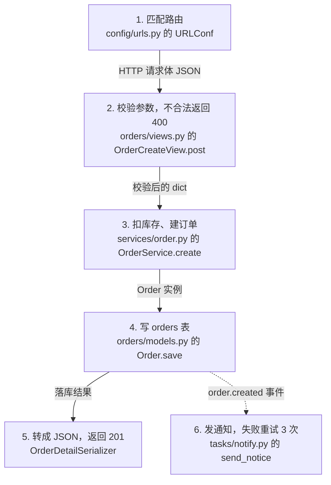

# shop 阅读导航

## 0. 一句话画像

B2C 商城后端，给小程序和 H5 提供下单、支付、售后接口。6 个 app，约 3.2 万行。

## 1. 怎么跑起来（静态推断，我未实际执行）

| # | 步骤 | 命令 / 配置 | 证据 | 错了会看到 |
|---|---|---|---|---|
| 1 | Python 3.11+ | `requires-python = ">=3.11"` | `pyproject.toml:18` 【文档明示】 | `SyntaxError` 指向 `match` 语句 |
| 2 | PostgreSQL 14+ | `image: postgres:14` | `docker-compose.yml:12` 【文档明示】 | `connection refused` on `:5432` |
| 3 | 复制环境变量 | `cp .env.example .env` | `README.md:31` 【文档明示】 | `KeyError: 'SECRET_KEY'`（.env.example 里没有默认值的有 3 个） |
| 4 | 装依赖 | `pip install -r requirements.txt` | `requirements.txt` 【文档明示】 | `pg_config not found` → 先装 postgresql-dev |
| 5 | 建表 | `python manage.py migrate` | `Makefile:8` 【代码推断】 | `relation "orders_order" does not exist` |
| 6 | 启动 | `python manage.py runserver` | `README.md:38` 【文档明示】 | 访问 `/healthz` 应返回 200；404 说明路由没注册 |

> 【未知】没有找到 Redis 的启动说明，但 `settings.py:61` 引用了 `REDIS_URL`，且 Celery 在 `INSTALLED_APPS` 旁配置了 broker。推测需要 Redis，但缺证据。

## 2. 阅读路线（8 站，按依赖方向）

### 第 1 站：配置与外部依赖（约 40 分钟）

**为什么排这**：库版本和外部服务能在这里一次看完。
**要读**：`config/settings.py`、`.env.example`、`docker-compose.yml`
**读完你应该能说出**：连哪个库、有哪几个外部服务、密钥从哪来。

### 第 2 站：订单数据模型（约 40 分钟）

**为什么排这**：状态枚举只在这里定义，第 3 站全靠它。
**要读**：`apps/orders/models.py`、`apps/orders/migrations/0001_initial.py`（只看字段）
**读完你应该能说出**：订单有哪几个状态、怎么流转、和支付/库存什么关系。

### 第 3 站：下单主链路（约 60 分钟）

**为什么排这**：近三个月改动最多的三个文件都在这。
**要读**：`apps/orders/views.py`、`apps/orders/schemas.py`、`apps/orders/services/order.py`、`apps/orders/clients/inventory.py`
**读完你应该能说出**：一次下单从进来到落库经过哪几步、库存什么时候扣、失败时什么不回滚。

> 后续第 4~8 站：支付回调、售后、用户与权限、公共组件、定时任务……写法同上，此处从略。

## 3. 一次请求的完整旅程

第 1 步承接小程序的下单请求。第 3 步最复杂，它同时碰库存和订单两张账，而这两个存储没有共同事务。

第 6 步是虚线：下单接口不等通知完成，通知失败不影响下单成功。

> 已知坑：第 3 步扣库存成功、第 4 步写库失败时，库存不会回滚。
> 未找到补偿逻辑，搜索范围是 `services/order.py` 全文加全仓 `grep -rn "rollback|compensat|release"`，0 命中。搜不到不等于不存在。

## 4. 模块地图

| 目录 | 这是什么 | 要不要看 |
|---|---|---|
| `config/` | 全局配置、路由总表、WSGI 入口 | 进站（第 1 站） |
| `apps/orders/` | 下单、支付、售后，全项目最厚（8.1k 行） | 进站（第 2~3 站） |
| `apps/payments/` | 支付渠道对接，回调在这里 | 进站（第 4 站） |
| `apps/users/` | 登录注册、权限 | 不用关注（要改权限时再单独看） |
| `apps/common/` | 分页、异常、响应包装 | 不用关注 |
| `apps/tasks/` | Celery 异步任务 | 不用关注（除了库存对账 `stock_reconcile.py`） |
| `scripts/` | 运维脚本，不在请求链路上 | 不用关注 |
| `third_party/` | 第三方 SDK 拷贝 | 别改（升级时整体替换） |
| `tests/` | 42 个测试文件，是行为的最好证据 | 不用关注（读完主线再回来扫） |

> 只有 4 个目录进站，其余全部"不用关注"。这是故意的：注意力集中在主干上。

## 5. 改动地图

### 给订单加「备注」字段

1. `apps/orders/models.py` — 加字段 + 生成迁移 ← 先做，否则后面全报错
2. `apps/orders/schemas.py` — 加字段 ← 不加，API 收不到
3. `apps/orders/services/order.py` — `create()` 透传 ← 不加，值会丢

**影响面**：订单列表接口、导出 CSV、对账脚本（是否读备注：待确认）
**验证**：`tests/test_order_create.py::test_create`
**风险**：迁移上线要考虑存量数据的默认值

### 改下单校验规则

1. `apps/orders/schemas.py` — 校验写在这里，不在 view
2. `apps/orders/services/order.py` — 如果规则依赖库存/用户状态，要在这加

**影响面**：小程序下单接口、H5 下单接口（共用同一 schema）
**验证**：`tests/test_order_create.py`

### 排查「库存多扣」

1. `apps/orders/services/order.py:58` — 看事务范围和异常处理
2. `apps/orders/clients/inventory.py:12` — 看超时和重试

**影响面**：售后补偿任务 `apps/tasks/stock_reconcile.py`
**验证**：暂无测试覆盖这块（`tests/` 里没有对应文件）

## 6. 术语表

| 术语 | 一句人话 | 本项目实例 |
|---|---|---|
| serializer | 把 JSON 变成 Python 对象，顺便查格式对不对 | `apps/orders/schemas.py:14` |
| 事务边界 | 一组要么全成功、要么全回滚的操作范围 | `services/order.py:58` 的 `@transaction.atomic` |
| 信号 | 某个动作发生后自动触发的钩子 | `orders/signals.py:9` 监听 `post_save` |
| Celery | 异步任务队列，把慢活扔到后台 | `apps/tasks/` |

## 7. 没覆盖 / 存疑

- 【未读】`tests/` 下 42 个测试文件未读——它们是行为的最好证据，建议读完全部主线后回来扫一遍
- 【存疑】支付回调入口没找到，可能在 `apps/payments/` 之外或另一个仓库
- 【未知】Redis 是否必需（见第 1 节）

## 8. 这个分支怎么用

- IDE 里全局搜 `[READ]`，按站号顺序跳
- 每个跳转点看箭头：`←` 是你从哪来，`→` 是你要去哪
- **别在这个分支改业务代码**，它只是你的笔记
- 想给团队用：删掉「读完你应该能说出」这类口语和「不用关注」的括注，就是 onboarding 文档
