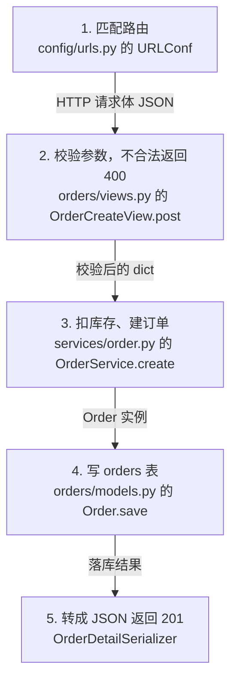

# 一次请求的完整旅程

路线图回答"先读什么"，旅程图回答"这些东西怎么串起来"。缺了后者，读者会有"每个文件都懂、但连不成一件事"的感觉。

## 为什么不用时序图

时序图有多条竖线和交叉箭头，不熟的人要在几条线之间来回找"谁在什么时候调用谁"。阅读场景下，时间顺序就是从上往下读。

## 规格

- **只画一条**主链路。三条会稀释重点。
- **5~8 步**。超过 8 步，拆成"主链 5 步加一个子链路"。
- 每步两行：**这一步在干什么**，下一行写**在哪个文件的哪个符号**。
- 箭头旁标**传的是什么数据**（最容易忽略、但最能建立直觉的信息）。
- 末尾单独标**已知的坑**。

## 选哪条链路

优先级：

1. 用户选的范围里最高频的动作（下单、登录、发消息）
2. 路由表里路径最短、参数最少的那个
3. 最近改动最频繁的入口（`git log` 排序）

## Mermaid 模板

````markdown

````

配套文字**不超过两句**：这条链路解决什么问题、哪一步最复杂。坑单独写一行。

## 纯文字版（必须同时给）

终端和纯文本编辑器渲染不了 Mermaid。给一份信息量不减的版本：

```
1. config/urls.py 的 URLConf                    匹配路由
2. orders/views.py 的 OrderCreateView.post      校验参数，失败返回 400
3. services/order.py 的 OrderService.create     扣库存、建订单
4. orders/models.py 的 Order.save               写 orders 表
5. OrderDetailSerializer                        转成 JSON，返回 201
```

## 允许回边（循环）

有些主链是环：Agent 循环、消息重试、状态机自转。

**不要画成首尾相连的圈**，用一条回边指回循环起点，并标清退出条件：

```mermaid
    G -->|下一轮带上历史| B
    E -->|这是最终答案| H["8. 返回结果"]
```

配一句说明："第 2 步到第 7 步会转很多圈，直到第 6 步给出答案或步数用完。"

只画直线会让人误以为跑一次就结束，这是读 Agent、任务队列类项目时最常见的误解。

## 写法要求

- 节点第一行写**动作**，第二行写**位置**（文件 的 符号）。不写行号，注释会移动行号。
- 箭头标签写**数据形态**（JSON、dict、实例、响应），不写"调用"。
- 一个节点只放一个动作，"校验并落库"要拆开。
- Mermaid 节点标签用双引号包裹，避免中文、冒号、斜杠导致渲染失败。
- 编号用 `1. 2. 3.`，不用圈号。

## 与注释的配合

旅程图里的每个节点，都应该在对应文件的 L1 注释里找得到同样的上下游关系。两处不一致，说明有一处写错了，回去核对。
