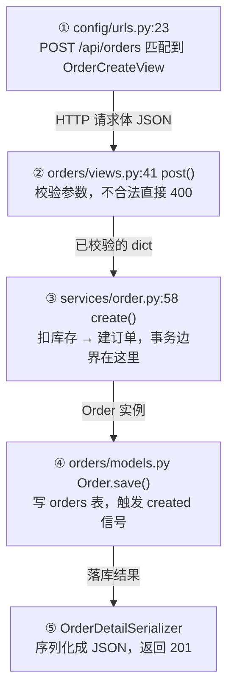

# 一次请求的完整旅程

路线图回答"先读什么"，旅程图回答"这些东西怎么串起来"。缺了后者，用户会有"每个文件都懂、但连不成一件事"的感觉。

## 为什么不用时序图

时序图有多条竖向生命线和交叉箭头，不熟悉的人要在几条线之间来回找"谁在什么时候调用谁"。阅读场景下，**时间顺序 = 从上往下读**，竖向流程图就够了。

## 规格

- **只画一条**主链路。三条会稀释重点，也读不完。
- **5~8 步**。超过 8 步拆成"主链 5 步 + 一个子链路"。
- 每步写三样：**序号 + 文件 · 符号 + 这一步在干什么**（不写行号）。
- 箭头旁标**传的是什么数据**——这是最容易被忽略、但最能建立直觉的信息。
- 末尾单独标**已知的坑**。

## 选哪条链路

优先级：

1. 用户在 S0 选的范围里最高频的动作（下单、登录、发消息）
2. 路由表里路径最短、参数最少的那个（通常是核心）
3. `git log` 最近改动最频繁的入口

## Mermaid 模板

````markdown

````

配套文字**不超过两句**：这条链路解决什么问题、哪一步最复杂。坑单独写一行，不要混在解释里。

> ⚠️ 已知坑：第 ③ 步扣库存成功、第 ④ 步写库失败时，库存不会回滚——代码里没有分布式事务补偿。

## 同步链之外：异步分支

如果发现 Celery / 队列 / 事件总线，**不要另画一张全程图**，在主链末尾拉一条虚线分支：

```mermaid
    C -->|order.created 事件| Q["⑥ Celery: tasks/notify.py:22<br/>发通知，失败重试 3 次"]
```

配一句最关键的话：

> 下单接口不等通知完成，所以**通知失败不影响下单成功**。

"哪些步骤同步必须成功、哪些异步可以失败"——这是新手最容易搞错、也最容易在改动时踩坏的地方。不写这句，等于没画。

## 可选：核心表关系图

如果项目有 3 张以上互相关联的核心表，加一张 `erDiagram`。它回答"这个概念和谁有关"，是旅程图之外最值钱的一张图。

只画核心 3~5 张，字段只留主键、外键、状态字段。**不要画全库**——全库 ER 图没人看。

## 纯文字版（必须同时给）

终端、纯文本编辑器、部分聊天窗口渲染不了 Mermaid。同时给一份等价的文字版，信息量不减少：

```
① config/urls.py:23     POST /api/orders → 匹配路由
② orders/views.py:41    校验参数（失败 400）          ← 传：JSON
③ services/order.py:58  扣库存 + 建订单                ← 传：dict
④ orders/models.py      写 orders 表                   ← 传：Order 实例
⑤ OrderDetailSerializer 转 JSON，返回 201              ← 传：落库结果
```

## 写法要求

- 节点文字里**写「文件 · 符号」**，不写行号（注释会移动行号，行号会失效）
- 箭头标签写**数据形态**（JSON / dict / 实例 / 响应），不写"调用"
- 不要在一个节点塞两个动作（"校验并落库"要拆开）
- Mermaid 节点标签用双引号包裹，避免中文、冒号、斜杠导致渲染失败
- 步骤编号用 `① ② ③`，和对话里的讲解编号保持一致

## 允许回边（循环）

有些主链不是直线，而是环：Agent 循环、消息消费重试、状态机自转。

**环不要画成首尾相连的圈**，用一条回边指回循环起点，并标清退出条件：

```mermaid
    G -->|下一轮带上历史| B
    E -->|is_final_answer| H["⑧ 返回结果"]
```

配一句说明：「② 到 ⑦ 会转很多圈，直到 ⑥ 给出最终答案或步数用完。」

只画直线会让人误以为是"跑一次就结束"，这是读 Agent / 任务队列类项目时最常见的误解。

## 与注释的配合

旅程图里的每个节点，都应该在对应文件的 L1 注释里能找到同一个上游/下游关系。两处不一致，说明有一处写错了，回去核对。
